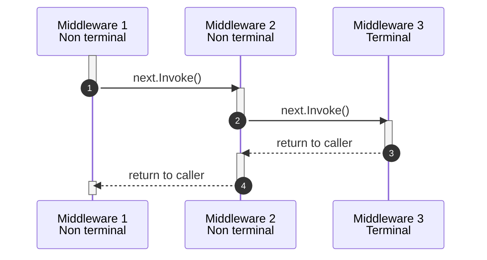

# Les intergiciels

Une requête HTTP traverse une chaîne de composants, appelés **intergiciel** ou *middleware*.

Leur exécution suit un modèle de pile. Il en existe deux types :
- **Non terminal** : peut effectuer un traitement avant d'appeler le suivant ainsi qu'à son retour
- **Terminal** : effectue un traitement et clôt le parcours de la requête.



## Création d'un intergiciel

Les intergiciels sont implémentés sous forme de **délégués** prenant un ```HttpContext``` et retournant un ```Task```.

```csharp
var builder = WebApplication.CreateBuilder(args);
var app = builder.Build();

// Non terminal middleware
app.Use(async (context, next) =>
{
    await context.Response.WriteAsync("Hello from the first middleware!\n");
    await next.Invoke();
    await context.Response.WriteAsync("Hello again from the first middleware\n");
});

// Terminal middleware
app.Run(async (context) =>
{
    await context.Response.WriteAsync("Hello from the terminal middleware!\n");
});

// Starts the app
app.Run();
```

```console
Hello from the first middleware!
Hello from the terminal middleware!
Hello from the first middleware after next!
```

> [!NOTE]
> Le délégué ajouté avec ```app.Use``` peut être de type *terminal* ou *non terminal*. Ceux qui le sont avec ```app.Run``` sont toujours de type *terminal*.

## Intergiciels embarqués

ASP.NET embarque un [certain nombre d'intergiciels](https://learn.microsoft.com/en-us/aspnet/core/fundamentals/middleware/). Parmi les plus courants nous pouvons retenir :

| Intergiciel               | Description                                                                           |
|---------------------------|---------------------------------------------------------------------------------------|
| ```UseHttpsRedirection``` | Redirige les requêtes HTTP vers HTTPS                                                 |
| ```UseHsts```             | Prend en charge l'entête HTTP Strict Transport Security                               |
| ```UseAntiforgery```      | Empêche les attaques CSRF                                                             |
| ```UseAuthentication```   | Exeute le mechanisme d'authentification configuré et renseigne ```HttpContext.User``` |

> [!WARNING]
> L'ordre de l'utilisation des intergiciels est important. Il convient de lire les instructions d'utilisation de chacun d'eux afin d'éviter des incidents.